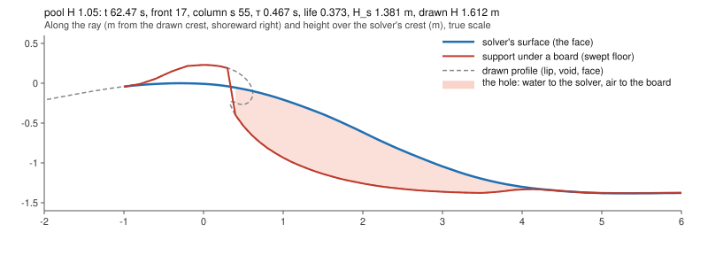

# The Wave Pool Barrel's hole: why riders fall through the tube (2026-11-03)

Step 2 of the surfable-tube plan (`docs/superpowers/plans/2026-11-03-pool-surfable-tube.md`): find the hole. This is a
measurement and diagnosis, not a fix. Nothing in the game changes on this branch. Branch `claude/pool-tube-hole` from main
4eee1e5f. No rider sessions, catch reports, ride reports or autopilot checks were run.

## Where it stands

- **Done.** The probe, the four runs (1.5 and 1.8 m, the default cases and `a38`, 12 periods each), a crash-off check and
  one dumped section are measured and committed. The cause is found (below).
- **Built:** `src/wave/probes/poolTubeHole.probe.test.ts`, opt-in (`PROBE=1`). It is a test file only, with no hooks in
  game code.
- **Results:** `runs/hole-{pool,a38}-{1.05,1.32}.txt` (the full runs), `runs/hole-pool-1.05-short.txt` and
  `runs/hole-pool-1.05-crash-off.txt` (4 periods each), `runs/section-pool-1.05.txt` (one section), drawn in
  `section-pool-1.5m.svg`.
- **No ride-camera frames:** the section drawing shows the cause more plainly than a still would.

## Next steps

1. Step 3, the advisor's design check: hand over "What the advisor should decide" (the end of this file) with these
   numbers.
2. Not needed for step 3, open if wanted: the same probe at Padang Padang (the same system), and the drawn clock's 2× rate
   (see "The timing") traced to its cause.

## How to verify

- **Types:** `npx tsc --noEmit -p .`
- **The probe** (CPU; 12 periods take about 11–12 min on the M1, 4 periods about 4.5 min):
  `PROBE=1 H=1.05 CASE=pool LOG=runs/hole-pool-1.05.txt npx vitest run src/wave/probes/poolTubeHole.probe.test.ts --maxWorkers=2`
  - `H=1.32` for 1.8 m; `CASE=a38` for the stand-in; `PERIODS` (12), `SETTLE` (50 s);
  - `BODIES=0` skips the bodies; `CRASH=off` turns the barrel's crash off (`?poolCrash=off`);
  - `DUMP=file` writes one section (the solver's surface, the support and the drawn profile) at the placement column.
- **The drawing:** `section-pool-1.5m.svg` is drawn from `runs/section-pool-1.05.txt`.

## The cause

The swept tube's piece replaces the water under the board, and its face lies far behind and below the solver's.
- **Where the board stands:** wherever the piece's loft is, the board's support is the loft's lowest crossing, not the
  solver's surface.
- **The piece's shape:** it hangs from the solver's crest and draws the Basilisk wave's own face, near vertical and only
  1.3–2.5 m from crest to toe. Past the toe it holds the case's trough level for another 2–3.4 m before easing onto the
  water.
- **The solver's shape:** its face is 6–10 m wide and never steeper than about 24°.
- **The result:** from the moment a column joins the front (the lip throws at the join, so there are no gentler pre-throw
  frames) until its tube has collapsed, the support under the solver's face lies 0.4–1.1 m (0.3–0.65 H) lower. A board on
  the face is in open air over the piece, not under its lip, and falls into that wedge. The piece's own lip and void sit
  inside the solver's water.

*One column (s 55) at 1.5 m, life 0.37. Blue: the solver's surface, the face a rider is on. Red: the support the board
gets. Shaded: the hole. Dashed: the drawn profile, whose lip curls down into the solver's water. True scale.*

## The tables

Values are medians over each run's column-frames (30 Hz reads at reef columns s 30–95 every 2.5 m; 168–262 column-waves a
run), in the open tube (life 0.5–0.8) unless said. d is the support minus the solver's surface at the solver's face points,
0.3 to 0.9 of its height H_s up from the trough.

### 1–2. The support and the hole

| | pool cases, 1.5 m | pool cases, 1.8 m | a38, 1.5 m | a38, 1.8 m |
| --- | --- | --- | --- | --- |
| Solver face H_s; drawn H | 1.38; 1.47 m | 1.61; 1.87 m | 1.41; 1.45 m | 1.63; 1.84 m |
| d at 0.3 / 0.5 / 0.7 / 0.9 of the face | −0.39 / −0.64 / −0.83 / −0.79 m | −0.51 / −0.80 / −1.04 / −0.99 m | −0.34 / −0.60 / −0.83 / −0.89 m | −0.48 / −0.79 / −1.06 / −1.13 m |
| The same in H_s | −0.31 / −0.49 / −0.63 / −0.60 | −0.31 / −0.49 / −0.64 / −0.60 | −0.25 / −0.44 / −0.60 / −0.65 | −0.30 / −0.48 / −0.63 / −0.66 |
| Reads with d < −0.1 m at mid-face | 100 % | 100 % | 100 % | 100 % |
| A board point at mid-face is in | open air, 100 % | open air, 100 % | open air, 100 % | open air, 100 % |
| Column-waves with a hole at mid-face | 182 of 182 | 262 of 262 | 168 of 168 | 249 of 249 |
| Its deepest (p50) | 0.66 m, 0.49 H_s | 0.85 m, 0.53 H_s | 0.62 m, 0.46 H_s | 0.82 m, 0.49 H_s |
| At the column's first read (τ 0.17–0.19 s), d at mid-face | −0.46 m | −0.60 m | −0.44 m | −0.60 m |
| The hole from / to (life, τ / touchdown) | 0.15 / 1.00 | 0.14 / 1.04 | 0.25 / 1.14 | 0.23 / 1.18 |
| Its span in the solver's time | 0.57 s | 0.67 s | 0.40 s | 0.43 s |

- **Every bin is a hole.** d is just as negative after the throw (life 0–0.25: −0.48 m at mid-face at 1.5 m) and
  through the collapse (−0.48 m). The support rejoins the solver only at the trough (0.1 of the face: −0.01 to −0.1 m)
  and past the forward rest.
- **Under the crest (0.9 of the face),** 10–25 % of the reads lie in the piece's water instead: its crest stands 0.1–0.3 m
  over the solver's. Only 0–8 % of reads anywhere are under the piece's roof.

### 5. The mismatch

| | pool cases, 1.5 m | pool cases, 1.8 m | a38, 1.5 m | a38, 1.8 m |
| --- | --- | --- | --- | --- |
| Solver: face width crest to trough; steepest slope | 9.9 m; 0.43 (23°) | 10 m; 0.42 (23°) | 8.5 m; 0.44 (24°) | 10 m; 0.45 (24°) |
| Piece: toe from its crest; steepest slope | 1.56 m; 4.5 (77°) | 2.03 m; 6.1 (81°) | 1.30 m; 6.8 (82°) | 1.68 m; 8.8 (84°) |
| Mid-face offset, the piece's face behind the solver's | 1.81 m | 2.12 m | 2.06 m | 2.37 m |
| Crests: the solver's from the drawn, along the ray; the drawn's height over it | −0.1 m; +0.07 m | −0.1 m; +0.20 m | −0.2 m; +0.15 m | −0.2 m; +0.22 m |
| Troughs: the piece's lowest less the solver's | −0.02 m | −0.03 m | +0.01 m | 0.00 m |
| The drawn lip tip: ahead of the crest; height over the solver's surface | 0.82 m; −0.52 m | 1.03 m; −0.57 m | 0.82 m; −0.17 m | 1.05 m; −0.17 m |
| The void's height; the solver's water's fill of it (1: to its roof) | 0.08 m; 9.8 (life 0.25–0.5: 0.22 m; 2.2) | 0.10 m; 8.9 (0.30 m; 1.9) | 0.48 m; 1.5 | 0.64 m; 1.5 |
| Forward rest: the solver's water over the drawn trough at the toe; the hold past the toe | 1.03 m; 2.7 m | 1.27 m; 3.4 m | 1.06 m; 2.4 m | 1.31 m; 2.9 m |
| The wedge, the solver's water over the support (from the median sections) | 2.4 m² (1.2 H_s²) | 3.6 m² (1.4 H_s²) | 2.3 m² (1.1 H_s²) | 3.4 m² (1.3 H_s²) |
| The drawn clock in a column, s of τ a second | 2.03 (4-period run) | — | 1.96 | 1.76 |

- **Heights and levels agree; the horizontal shape doesn't.** The drawn crest, height and trough are within 0.0–0.3 m of
  the solver's (H +3 to +16 %). The piece is the solver's wave squeezed 4–6× toward its crest: a vertical wall where the
  solver has a 23° slope, and a flat trough shelf where the solver still has the lower half of its face.
- **The piece's hollow is where the solver has water.** The drawn tip curls down 0.2–0.6 m into the solver's water, and the
  void, 0.1–0.6 m tall, lies under the solver's surface: filled 1.5–10 times its own height over.
- **The timing.** The lip throws at the join (the pool's throw line lies deeper than its join: zero lag), so every slice
  starts thrown. No slice has τ < 0 in any run (0 of 55,000–132,000), and the piece appears already vertical.
  - The solver's breaking reaches the mid-face only at life 0.25–0.5 (strength 0.05 at life 0–0.25, 1.0 after).
  - Its crest cell never breaks (strength 0 throughout): Kennedy's breaking marks the front face.
  - The drawn clock runs at its 2× catch-up cap (`sliceClock.ts:188`) for most of the tube's life: 1.76–2.03 s of τ a
    second in a column, against 1.23 with the crash off. So a 1.24–1.40 s touchdown plays out in about 0.6–0.7 s. Inferred:
    the drawn lip then falls at about 4 g.

### 4. The board's fate (held bodies, no input, no autopilot)

Placed at reef s 55 on the solver's face (0.3 and 0.6 of H_s), in trim:
- moving shoreward with the crest (√(g h) there, 5.0 / 5.6 m/s) and along the line at the peel (6.3 / 7.4 m/s);
- pointed along their motion through the water;
- placed as the column's slice reaches life 0.3 (in the open tube), on the game's water (with the contact) and on the
  solver's alone (the A/B, on the same sea; the bodies' reactions not applied).

The counts are of 16 placements at 1.5 m and 24 at 1.8 m, except the lone board's (8 and 12).

| In the open tube | pool cases, 1.5 m | pool cases, 1.8 m | a38, 1.5 m | a38, 1.8 m |
| --- | --- | --- | --- | --- |
| Lone board: dropped > 0.1 m under the face, game / solver | 12 of 16 / 0 | 24 of 24 / 0 | 8 of 16 / 0 | 22 of 24 / 0 |
| ...first drop after; by (p50) | 0.15 s; 0.55 m | 0.15 s; 0.74–0.84 m | 0.5–1.0 s; 0.3–0.5 m | 0.5–0.7 s; 0.5–0.8 m |
| Prone rider still on at 3 s, game / solver | 4 / 15 | 3 / 24 | 7 / 15 | 3 / 24 |
| ...of the game's falls, after the board dropped | 10 of 12 | 21 of 21 | 5 of 9 | 11 of 21 |
| Standing rider: fell at (p50), game / solver | 0.38 / 0.55 s | 0.45 / 0.43 s | 0.29 / 0.55 s | 0.32 / 0.47 s |
| ...dropped before falling, game | 13 of 16 | 24 of 24 | 4 of 16 | 12 of 24 |
| The lip in a rider's part before the fall | 1 | 0 | 1 | 0 |

- **It falls.** On the solver's water no lone board drops and almost every prone rider is still on after 3 s. On the
  game's water the board drops 0.3–0.8 m within 0.15 s at the pool's cases: a free fall (½ g t² is 0.11 m at 0.15 s).
  Most riders come off right after the drop, with `lost board` (the flight limit), `impact` or `foot slip`.
- **It isn't crashed.** The lip reached a rider's part before the fall in 2 of 160 placements in the tube. Riders are
  seldom under the roof (`covered`) at all.
- **Placed ahead of the curl,** 0.3 s down the line and moving with it, bodies stay ahead and seldom drop: prone riders
  stay on 15–24 of 16–24 on both waters. At the join, the drops come later and fewer (3–7 of 8–12 boards).
- **The standing rider is no test:** with no input it falls in about 0.5 s on the solver's water too. The lone board and
  the prone rider are the measures.

### The crash's part (`runs/hole-pool-1.05-crash-off.txt`)

With the crash off (`?poolCrash=off`), the solver's own lip throws, and its face is lower (H_s 1.08 m against 1.42). The
piece, unchanged, stands 0.4–0.5 m over the solver's crest, and the hole stays (d −0.37 m at 0.7 of the face, −0.77 m at
0.9, life 0.25–0.5). So the crash (the pace, the jets taken from the crest) doesn't make the hole. It holds the piece's
crest on the solver's (offset −0.1 to −0.2 m, against −0.5 to +2.0 m without it).

## The code path

The swept contact does it. Carrier support, the held overturn and the crash don't move the support.

1. **The contact is built each step from every front point the pool draws** (`SurfZoneRunner.ts:613–622`,
   `updateContact`, from `SurfZoneSimulation.ts:1633` `writeTubeRecords`). At the pool there is no tube regime cut
   (`tubeFootMax` is Infinity without `tubeFrom`, `barrelSpots.ts:82–86`). The front follows crests on s 20–100
   (`poolStraightFrontAt`, `barrelSpots.ts:294`), and each point is thrown from its join (zero lag, `barrelSpots.ts:249`).
2. **The water answers from the loft wherever the loft is.**
   - `PhysicalSurfWater.ts:428` `const contact = swept !== undefined && swept.query(x, y, z, this.hit)`.
   - `:431` `if (contact) this.fromContact(y, out)`, which sets `surfaceY` to the swept surface at `:595`.
   - `surfaceAt` returns `swept.floorAt` (`:489`).
   - The condition is `SweptContact.strip` (`sweptContact.ts:459`) finding a joined strip whose rays bracket (x, z). A
     vertical line there must cross it: true over the whole slice, crest to extension, at weight > 0.
3. **The loft puts the piece's face there, off the water** (`sweptLoft.ts`).
   - `pin = 0` from just behind the crest to the toe (`:1252`).
   - So `e = w * (1 - pin)` is the slice's weight (`:1292`), and the vertex is `stillLevel + above`, the case's own
     height (`:1300`, `:1304`).
   - The profile hangs from the point's crest: `const ax = s.x - crest * nx` (`:1122`).
4. **Past the toe, the forward rest keeps the case's trough** (`sweptLoft.ts:1141`, `forwardRest` `:1354–1388`).
   - It holds `stillLevel + frontY` until the solver's water along the ray comes within `REST.near` (0.1 H) of it
     (`:1373`).
   - On the pool's broad face it never does: the solver stands 1.0–1.3 m over that level at the toe. So the hold runs to
     the cap (`:1361`, 3 H or the profile's own samples): 2.4–3.4 m past the toe.
5. **Not these:**
   - `CarrierSupport` is bounded-C only (`SurfZoneSimulation.ts:1255`); the pool draws raw Basilisk frames.
   - The held overturn (`heldOverturn.ts`) sizes the crash's jet and void (`crashCurve.ts:148`). In contact mode the loft
     holds each case at its clear frame (`ProfileLibrary` hold `contact`), which shapes the void, not the face.
   - The crash (`SweptCrash`) paces the anchors after the throw (`SweptCrash.ts:238`, `:469–470`) and takes the jet's
     water from the crest. The crash-off run keeps the hole.

## What the advisor should decide

The facts each option in the plan's direction hinges on:

1. **"The face under the board is always the solver's surface."**
   - The solver's face here is 6–10 m wide and at most 23–24° (0.42–0.45) at both sizes. Its crest holds within 0.2 m of
     the piece's, its trough within 0.03 m.
   - A rider on it rides a moderate 23° face. The steep face a tube is ridden on doesn't exist in the solver.
   - Decide whether a ride on that face, under a roof drawn above it, is the barrel; or whether the face itself must be
     steepened, and then by what (and how that support stays continuous for a board already on it).
2. **"The tube grown from the solver's own thrown lip."**
   - From the median sections, the solver's surface falls 0.15 / 0.51 / 0.93 m at 1 / 2 / 3 m ahead of its crest at
     1.5 m (0.14 / 0.47 / 0.89 m at 1.8 m).
   - A lip launched level from that crest clears it only if it moves faster than the crest by 5.7 / 6.2 / 6.9 m/s (1.8 m:
     5.9 / 6.5 / 7.0 m/s) in the wave's frame (inferred: ballistic, ½ g t²). The crest itself moves at 5.0 / 5.6 m/s.
   - So a jet at about the crest's speed lands on the solver's face within about a metre of the crest, with no room under
     it. Decide what roof the solver's own crest can give, and what the hollow's height follows.
   - The crash already takes each jet's water from the crest's upper half. With it off, the solver's own lip lowers the
     face to H_s 1.08 m.
3. **"The M4 cases add detail only."**
   - The cases' scale is right in height (drawn H within +3 to +16 % of the solver's, troughs within 0.03 m).
   - Their horizontal shape is 4–6× narrower than the solver's wave (toe 1.3–2.0 m from the crest against a 6–10 m
     face). Their lip and void hang 0.2–0.6 m inside the solver's water.
   - Their hollow (0.1–0.3 m for the pool's cases, 0.5–0.6 m for a38) is smaller than the solver's water over it. Decide
     what of a case can be carried onto a face this broad (lip thickness, tip, curl), and in what frame (from the
     crest, from the face, scaled by H or by the face's width).
4. **"The lip's contact is an impact."**
   - Today the lip seldom touches a rider: 2 of 160 placements in the tube, against 60–90 % falling into the hole
     first.
   - The drawn clock runs at about 2× (1.76–2.03 s of τ a second, its catch-up cap), so the lip's flight plays in about
     0.6–0.7 s instead of 1.24–1.40 s. Inferred: the drawn lip falls at about 4 g.
   - Decide whether the impact keys on the drawn lip's place and time, or on the solver's crest and its jets, and
     whether the clock's catch-up is kept.
5. **The transition.** The pool throws at the join (zero lag). The piece starts vertical, and the support steps 0.44–0.60
   m down at mid-face in the first read (τ 0.17–0.19 s). Any piece that replaces the support needs a start continuous
   with the solver's face, as the pre-throw frames would give if the throw lagged the join.

## Caveats

- **Reads sit 2 cm into each strip.** A point exactly on a slice's ray can round off both strips beside it (float32
  positions) and read the solver: 25–40 % of exact-ray reads did. A board covers many strips; this seam is not counted as
  support.
- **The medians are of column-frames,** a column-wave contributing 7–24 reads; the hole spans and depths are per
  column-wave.
- **The bodies' reactions are not applied** (the sea is shared by the A/B). The standing rider with no input falls on
  both waters, so its numbers only show that it falls sooner and after a drop on the game's water.
- **The 1.8 m runs and the a38 runs show the same cause.** The a38 void is larger but just as submerged.
